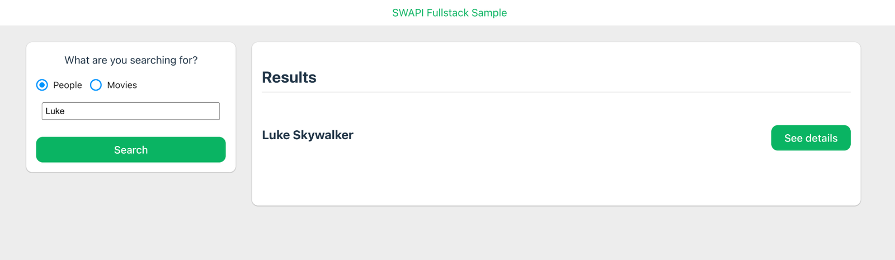
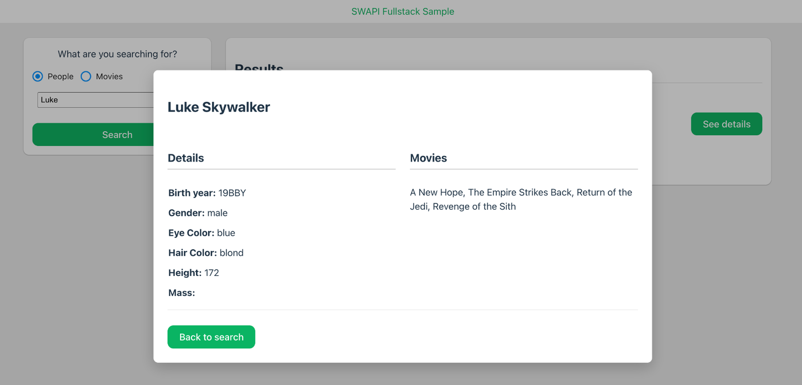
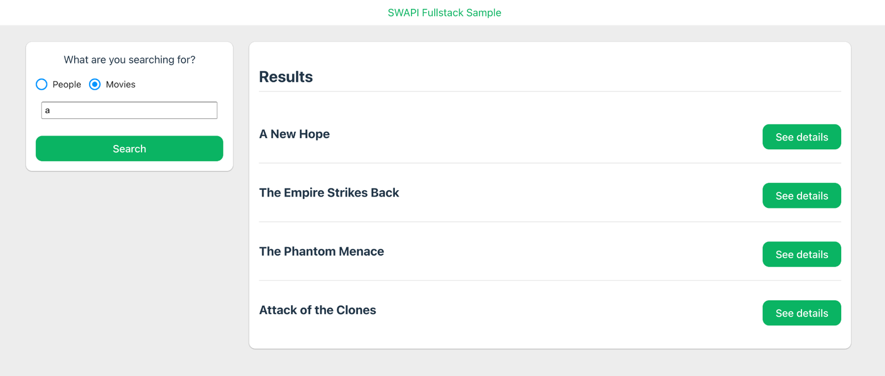
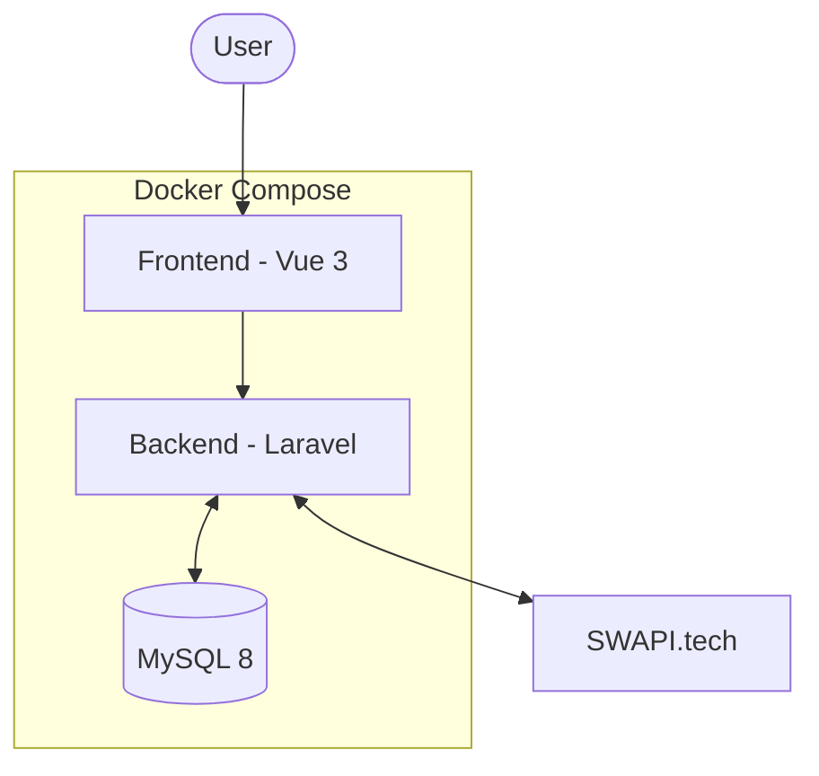

# SWAPI Fullstack Sample

A personal full-stack application built with **PHP 8.2, Laravel 10, Vue 3, TypeScript, MySQL 8, and Docker**.

The application uses [SWAPI.tech](https://swapi.tech/) to search for Star Wars characters and movies, display details and related data, and store character search logs.

**Author:** [Bruno Heitzmann Almada](https://www.linkedin.com/in/brunoheitzmannalmada/)

## About This Project

I created SWAPI Fullstack Sample as a personal project to keep my skills with PHP, Laravel, and Vue 3 active through hands-on development.

The application demonstrates how a Vue frontend communicates with a Laravel REST API, which retrieves information from an external data source and persists search activity in a relational database.

The project is intentionally small and focused, providing a practical environment for exploring full-stack development and software engineering concepts.

It also serves as a foundation for continuous improvement, with planned enhancements in API resilience, caching, concurrent requests, background processing, accessibility, and automated testing.

## Application Preview

### Character Search

Search for characters by name and view matching results.



### Character Details

Open a character to see personal attributes and related movies.



### Movie Search

Search for Star Wars movies by title.



## Features

- Search for Star Wars characters by name.
- Search for Star Wars movies by title.
- View character details and their related movies.
- View movie details and related characters.
- Record successful character search requests in MySQL.
- Expose a REST API that separates the Vue frontend from SWAPI.tech.
- Access the latest stored search statistics through an API endpoint, when a statistics snapshot is available.
- Run the application locally using Docker Compose.

## Tech Stack

| Layer | Technologies |
| --- | --- |
| Backend | PHP 8.2, Laravel 10 |
| Frontend | Vue 3, TypeScript, Vite, Axios |
| Database | MySQL 8 |
| External API | [SWAPI.tech](https://swapi.tech/) |
| Local development | Docker, Docker Compose |

## Architecture Overview



**How it works:**

1. The **Vue 3 frontend** provides the search interface and requests data through `/api` endpoints.
2. During local development, the **Vite proxy** forwards `/api` requests to the Laravel backend.
3. The **Laravel backend** fetches character and movie data from SWAPI.tech and returns JSON responses to the frontend.
4. Successful character searches are logged to **MySQL** and emit a `SearchPerformed` event.
5. The statistics endpoint reads the latest stored statistics snapshot, if one exists.

A statistics job and a five-minute Laravel schedule are present in the codebase, but the current Docker Compose setup **does not start a scheduler or queue worker automatically**. See [Current Limitations and Roadmap](#current-limitations-and-roadmap).

## API Endpoints

| Method | Endpoint | Purpose |
| --- | --- | --- |
| `GET` | `/api/star-wars/people?search=Luke` | Search characters by name |
| `GET` | `/api/star-wars/people/{id}` | Get a character and related movie titles |
| `GET` | `/api/star-wars/movies?search=Hope` | Search movies by title |
| `GET` | `/api/star-wars/movies/{id}` | Get a movie and related character names |
| `GET` | `/api/star-wars/statistics` | Get the most recently stored statistics snapshot, if available |

The statistics endpoint returns `404` when no statistics snapshot has been stored yet.

## Getting Started

### Prerequisites

- [Git](https://git-scm.com/)
- [Docker](https://www.docker.com/) with Docker Compose support

No local PHP, Composer, Node.js, or MySQL installation is required for the Docker-based setup.

### 1. Clone the Repository

```bash
git clone https://github.com/brunoheitzmannalmada/swapi-fullstack-sample.git
cd swapi-fullstack-sample
```

### 2. Configure the Backend Environment

```bash
cp backend/.env.example backend/.env
```

The example environment file contains local development settings matching the MySQL service in `docker-compose.yml`.

### 3. Build and Start the Containers

```bash
docker compose up --build -d
```

The Compose file defines three services: `backend`, `db`, and `frontend`.

### 4. Install Backend Dependencies

```bash
docker compose exec backend composer install
```

Frontend dependencies are installed during the frontend image build.

### 5. Generate the Laravel Application Key

```bash
docker compose exec backend php artisan key:generate
```

### 6. Run Database Migrations

```bash
docker compose exec backend php artisan migrate
```

If MySQL has not finished initializing, check `docker compose logs db` and retry this command once it is ready.

### 7. Open the Application

- **Frontend:** [http://localhost:5173](http://localhost:5173)
- **Backend:** [http://localhost:8000](http://localhost:8000)

For example, you can inspect the people search API at [http://localhost:8000/api/star-wars/people?search=Luke](http://localhost:8000/api/star-wars/people?search=Luke).

The application fetches live data from SWAPI.tech, so external API availability currently affects search and detail requests.

## Useful Commands

```bash
# List running services
docker compose ps

# View backend logs
docker compose logs -f backend

# View database logs
docker compose logs -f db

# Run migrations
docker compose exec backend php artisan migrate

# Open a shell in the backend container
docker compose exec backend bash

# Stop containers without deleting the database volume
docker compose down

# Start the containers again
docker compose up -d
```

## Current Limitations and Roadmap

The project is being improved incrementally. The following items are **planned**, not presented as completed features:

- **API resilience:** add backend caching, timeouts, and a fallback strategy for previously retrieved data when SWAPI.tech is unavailable.
- **Statistics processing:** run the scheduler and queue worker properly, review event-driven processing, and expand the statistics implementation.
- **Concurrent requests:** fetch related movies and characters concurrently where appropriate, rather than making sequential HTTP requests.
- **Frontend data fetching:** introduce a query and caching library to manage loading, retries, and cached server state.
- **Accessibility and usability:** improve form labels, keyboard interaction, loading and error states, and feedback to users.
- **Automated testing:** add meaningful backend and frontend tests, including external API failure scenarios.
- **Framework maintenance:** plan an upgrade from Laravel 10 to a currently supported version.

The current implementation is a **learning and portfolio project**, not a production-hardened service.

## License

This project is licensed under the [MIT License](LICENSE).

Star Wars names and related content belong to their respective rights holders. This project is not affiliated with or endorsed by Lucasfilm or Disney.
